# Portal Break — Devlog

Game Off 2026 · theme **SHIFT** · deadline Dec 1, 13:37 PST

Each entry is written to double as a YouTube script: what changed, why, and the shots to show.

---

## Day 1 — Nov 12: From sidebar puzzle to neon twin-stick

**Before:** a 2D canvas maze. You collected artifacts, dodged red circles, and most of the game lived in an HTML sidebar.
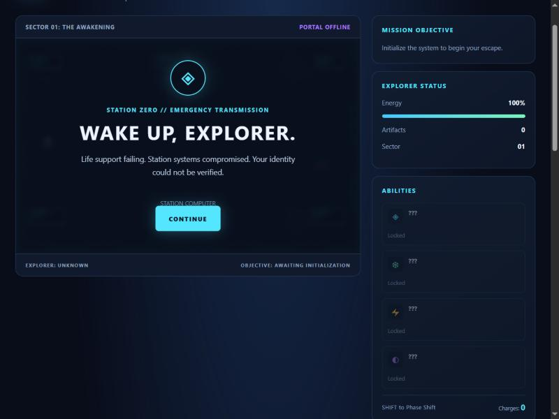

**Goal:** make it look and feel like an isometric cyberpunk twin-stick shooter, and make SHIFT the core mechanic instead of a random teleport.

### The big idea
**SHIFT phases you between two versions of the same district:**
- **CITY:** holo-barriers block streets. Drones and turrets patrol. Terminals can be hacked.
- **BREACH:** barriers vanish, red crystals grow in other places, and a bridge appears over the chasm. Wraiths hunt you, and rift nodes can be hacked. It drains your phase energy.
- You **can't shift into something solid**. Standing on the Breach bridge and shifting to City gets blocked, because there's no floor there.
- Enemies only exist in their own world. In the other one they're harmless ghosts, so you can shift to escape a fight.

### What got built (all in one session)
- **Engine:** Three.js loaded from a CDN, plain ES modules, no build step.
- **Look:** 60° angled camera with aim look-ahead, wet floor reflections (PMREM env maps), bloom, a custom post shader (chromatic aberration, breach color grade, glitch lines on shift, damage vignette, scanlines), shadows from a moon light that follows the player, 8 pooled street-lamp lights, procedural neon signs, window-lit buildings, rooftop beacons, rain in the City and embers in the Breach.
- **Combat:** mouse aim, hold to fire, dash with i-frames, crits, damage numbers, hit-stop on kills, screen shake, explosions, health and phase pickups.
- **Enemies:** drones (strafe and shoot), turrets (3-round bursts), wraiths (pathfind with a BFS flow field, wind up, lunge).
- **Objective loop:** 4 locks (2 city terminals, 2 rift nodes). Each hack calls in reinforcements. All 4 open the exit portal.
- **Audio:** fully synthesized with WebAudio. A step-sequencer soundtrack re-voices itself darker in the Breach, plus rain ambience and every SFX.
- **HUD:** health and phase bars, objective banner, live minimap that swaps with the phase, dash cooldown, toasts, hack prompts.
- **F9 clip recorder:** records the game canvas plus audio to `.webm`, with no HUD. Use it for trailer footage.

### Shots for the video
| Shot | File |
|---|---|
| Title screen |  |
| First run: way too dark | 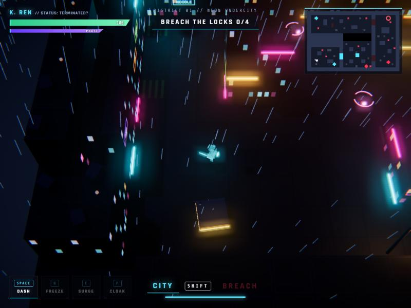 |
| After the lighting pass |  |
| SHIFT into the Breach | 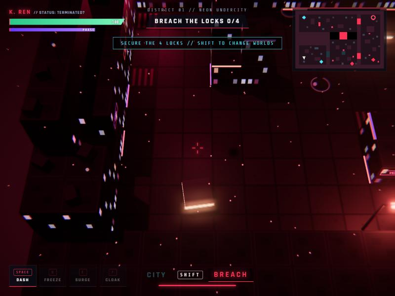 |
| Hacking a terminal |  |
| Lock breached, reinforcements |  |
| Combat: crit + loot drop |  |

### Bugs and lessons (good video moments)
- **Too dark on first run.** Neon only looks good when the surfaces around it are visible. Fix: tripled ambient and moon light, doubled lamp intensity, lightened ground and facades.
- **Died in 23 seconds standing still.** Two drones could see the spawn point. Fix: lower damage and range, plus a 2.5-second grace period.
- **Shift key not detected in automation.** Some environments report Shift only through `e.key`. Fix: fall back to `e.key`. Right-click also shifts (and saves you from Windows Sticky Keys).
- **Intel Iris Xe GPU.** Added auto quality: if FPS stays under 40 for the first 4 seconds, it drops MSAA, resolution and shadow size. There's also a manual toggle in the pause menu.

---

## Day 1, part 2 — Blender models

All four characters were modeled in Blender 5.2, driven live through the Blender connection, and exported as GLB files.

**Source file:** `art/portal_break_models.blend` (the build script lives inside it as the `pb_helpers.py` text block).
**Exports:** `assets/models/player.glb`, `drone.glb`, `turret.glb`, `wraith.glb` (13–103 KB each).

| Model | Design |
|---|---|
| ~~Kael Ren~~ (first-pass player) | Armored operative: visor helmet, high collar, long coat, glowing phase-core backpack, rifle. Replaced in part 3. |
| **Drone** | Hover body with a magenta eye, a spinning halo ring, side rotor pods and an under-slung gun. |
| **Turret** | Octagonal base with a glowing band, and a rotating head with twin barrels and an orange sensor strip. |
| **Wraith** | Crimson crystal body with a crown of spikes, blade arms, trailing tendrils, a glowing core and three orbiting shards. |

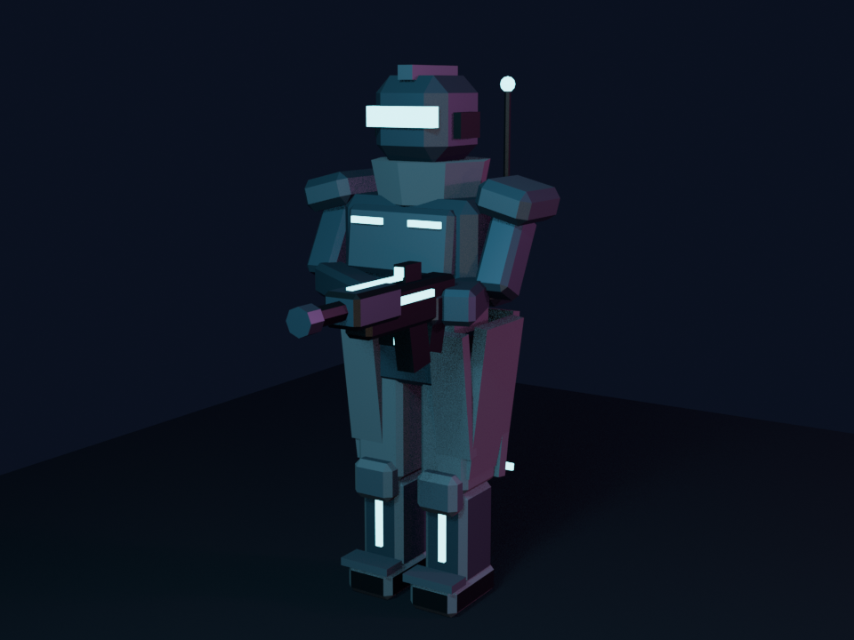

**The naming contract between Blender and the game:** materials named `Trim*`, `Core*`, `Eye*` or `Glow*` become unlit neon that the game recolors (cyan in the City, red in the Breach). Object names (`LegL`, `Gun`, `Muzzle`, `Head`, `Ring`, `Shell`, `Shard1-3`) are the parts the game animates. If a GLB fails to load, the old box stand-ins are used instead.

### Bugs and lessons
- **Detailed models broke the x-ray silhouette.** The "see yourself behind buildings" ghost also drew wherever the model's own parts overlapped, like the chest plate over the chest, which washed the player out. Fix: the player stamps a stencil mask, and the ghost only draws where a building actually hides the player.
- **The stencil buffer then went black on Intel graphics.** This Intel/Direct3D driver can't combine MSAA with a stencil buffer. Fix: dropped MSAA and added an FXAA pass, which is also cheaper on integrated GPUs.
- **Testing in a hidden browser.** Background tabs don't run animation frames, so screenshots came back black even though the game was fine. Added `__probe()`, which renders one frame on demand and measures brightness, so rendering can be checked without seeing it.

---

## Day 1, part 3 — Meet Jax Calder

The main character got a name and a real design. Reference sheets are in `art/reference/`. Jax uses the male turnaround: short dark hair, stubble, and a black tactical suit.

Rebuilt from scratch in Blender to match the sheet:
- **Front:** gunmetal chest plate with the **cyan ring emblem**, segmented ab plates, and cyan piping down the torso sides.
- **Back:** octagonal back module with a **cyan octagon** and X-straps.
- **Arms:** layered pauldrons, forearm bracers with cyan cuffs, fingerless gloves.
- **Lower body:** utility belt with pouches, silver thigh plates, knee pads, silver shin guards with bright edges, strapped boots.
- **Gameplay hook:** the chest ring and back octagon use the `Core` material, so they glow **cyan in the City and red in the Breach**.

| Front | Three-quarter | Back |
|---|---|---|
| 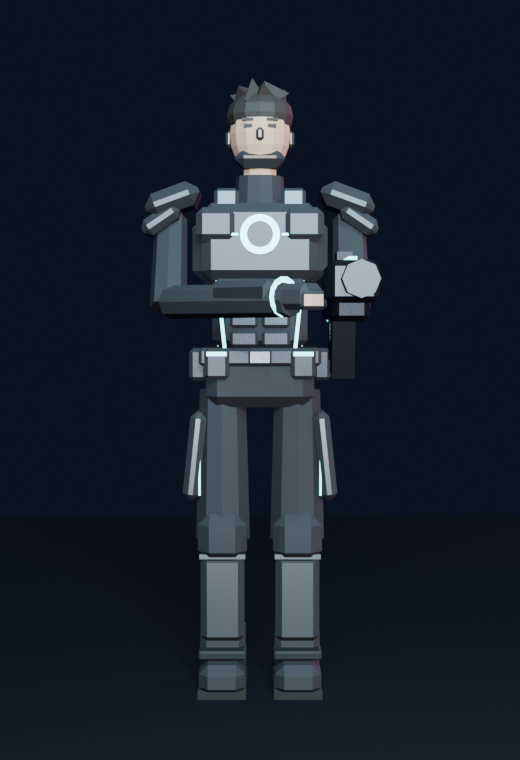 |  |  |

The name is now in the game: the HUD callsign reads `J. CALDER`, and the story's opening transmission reads *"Personnel record found: JAX CALDER. Status: TERMINATED."*

Fix along the way: the first hair cap only covered the top of the head, so the back of the skull showed skin from behind. Added a back and sides hair piece.

---

## Day 1, part 4 — Playtest feedback: "too dark, can't see where to go, too much flashing"

**Readability**
- Brighter overall: more ambient and moon light, stronger street lamps, thinner fog, lighter floor, and a softer vignette. The Breach gets a brighter sky tint so it no longer turns into a red void.
- **Objective beams:** a tall soft light column over every remaining terminal and rift node, visible over the rooftops. It's brightest when you're in the world that can hack it.
- **Waypoint marker:** always points to the nearest unfinished objective, e.g. `RIFT NODE // BREACH 10m`. When the target is off-screen, it pins to the screen edge and points the way.

**Flashing (photosensitivity pass)**
- Muzzle light: 18 → 4. It used to strobe 9 times a second while firing.
- Enemy shot flashes, kill flashes, the Shift screen flash, glitch and chromatic split, and screen shake all cut by 60–80%.
- No more player blink after taking damage, no flickering neon signs, and the low-health pulse is slow and soft.
- New pause-menu option: **SCREEN EFFECTS: CALM / OFF**. Off removes all flashes, shake and glitch. It defaults to Off when the OS "reduce motion" setting is on.

**The black-screen bug (a good debugging story for the video)**
- **Symptom:** in some areas the screen went black, or flickered black very fast.
- **Cause:** some frames contained NaN pixels on the player model. On a plain render they're invisible, but **bloom blurs them across the entire screen**, which turns the whole frame black.
- **Proving it:** stress-tested 135 spots × both worlds. Without a fix, about 50% of frames were black.
- **First fix failed:** a shader filter using `isnan()` did nothing, because Intel's Direct3D shader compiler optimizes `isnan()` away as "always false".
- **Real fix:** a filter pass before bloom that checks each pixel's raw bits (`floatBitsToUint`) for NaN or Infinity and zeroes them, and caps extreme highlights. Result: **0 / 135 black frames**.
- Also made the game recover when the browser tab starts at 0×0 size (another source of a black screen).

| City | Breach |
|---|---|
|  | 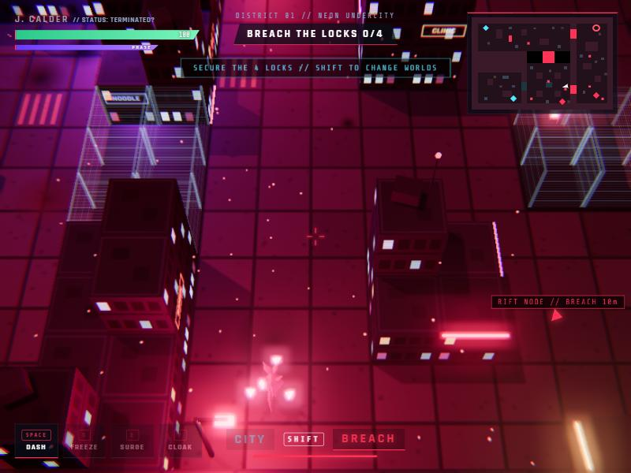 |

---

## Day 1, part 5 — Auto aim (on by default)

- While you fire, shots lock onto the enemy **closest to where your cursor points**: same world as you, within 17 m, in clear line of sight, and within about 40° of the cursor. A target that's already locked stays locked out to about 55°, so the lock doesn't jitter between enemies.
- A faint ring shows the current candidate. It tightens and brightens while you're firing, and Jax turns to face the target.
- **Pause menu → AUTO AIM: ON / OFF**, saved between sessions. The title screen shows the current setting.
- **Tested:** cursor 25° off a drone with auto aim off missed every shot; with it on, the drone died in 23 frames.
- **Playtest feedback: "it's not locking on."** The first version only locked within about 40° of the cursor and only while firing, which felt like nothing was happening. It now locks onto the **nearest visible enemy automatically**. Jax faces it even before you shoot, and the cursor direction only breaks ties between enemies. Verified: with the cursor 90° and even 160° away from a drone, it still locks on and kills it in under half a second.
- **Dev server:** added `serve.py`, a no-cache local server, so a normal reload always loads the newest game files. Run it with `python serve.py`.

---

## Day 1, part 6 — Polishing District 01

**Teaching the Shift in place.** One short hint at a time, each shown once, the first time it matters:
- Start: controls, and that auto aim locks on for you.
- Next to a holo barrier in the City: *"press SHIFT or RIGHT CLICK to phase into the BREACH, where it doesn't exist."*
- First time in the Breach: it drains your PHASE bar; shift back to recharge.
- At the chasm edge: the bridge only exists in the Breach.
- At breach crystals: shift back to the City to pass.
- Near faded enemies: they live in the other world and can't hurt you.
- When the portal opens: follow the marker.

**Checkpoints.** Every hacked lock saves a checkpoint. Dying then offers **RESPAWN AT CHECKPOINT** (Enter) with your hacked locks kept, full health and 2.5 seconds of protection, or **RESTART DISTRICT** (R).

**Feel**
- Health regenerates after 4 seconds without taking damage, so you're never stuck limping between fights.
- Shots knock enemies back slightly, so hits land with weight. Turrets stay put.

**Fixes**
- On narrow windows, the top banners no longer overlap each other.
- The waypoint marker steps aside while a hint is showing.
- The auto graphics check only measures while the game window is focused. Switching windows in the first few seconds used to wrongly force LOW graphics.

---

## Day 1, part 7 — District 02: Drowned Transit

**The rule:** each district adds one new Shift twist.

**New twist: City-only glass walkways.** They're the mirror image of District 01's Breach-only bridges. The district is a set of broken transit platforms over an abyss, joined by glass (City), rift bridges (Breach) and mixed crossings: *glass → solid island → Shift → bridge*. Shifting while standing on glass is blocked with a clear message (*"NO FLOOR UNDER YOU IN THE OTHER WORLD"*). Drones fly over the abyss and hit you while you cross.

**New enemy: Rift Turret.** The Blender turret recolored crimson, existing only in the Breach. It gives the Breach a ranged threat, so it isn't just wraiths.

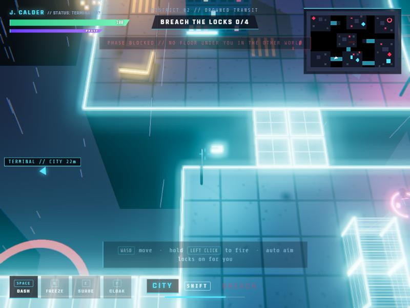

**Progression**
- Clearing a district saves progress and shows **NEXT DISTRICT**, then a short story scene (Voss, and a warning from the unknown transmission), then the next briefing.
- The title screen shows **CONTINUE // DISTRICT 02** once it's unlocked.
- Switching districts frees the old district's GPU memory, which matters on integrated graphics.
- New one-time hints for glass walkways and rift turrets. The basic hints don't repeat between districts.

**Verified:** every lock is reachable under the Shift rules (generator check). A full scripted run hacks all 4 locks and reaches the exit and the win screen. Shifting on glass is blocked. 0/90 black frames in a sweep of both worlds.

---

## Day 1, part 8 — "He looks like a robot. He's supposed to be a person who's dead in the system."

**Why v2 read as a robot:** hard-edged boxes with flat shading, stiff legs with no knees, metal plates everywhere, and glow on everything.

**Attempt 1 (failed):** rounding the separate box parts with subdivision. It made a balloon figure with sausage limbs and a bulb nose. Lesson: **a body has to be one continuous mesh**, not parts stuck together.

**What worked: Blender's Skin modifier.** Draw a stick-figure skeleton, give each joint a thickness, and Blender wraps one seamless body around it. Then:
1. A real **armature** (pelvis, spine, chest, head, thighs, shins, feet, arms), bound with automatic weights. Every vertex is weighted.
2. A posing test (walking stride) to check that the knees and hips deform like a person's.
3. **Dressed to match the reference**: chest plate with the cyan ring, octagon back module and X-straps, belt and pouches, thigh plates, knee pads, silver shin guards, bracers with cyan cuffs, fingerless gloves, short messy hair, stubble, face. Each piece is attached to the bone it rides on.

| Front | Three-quarter | Back |
|---|---|---|
| 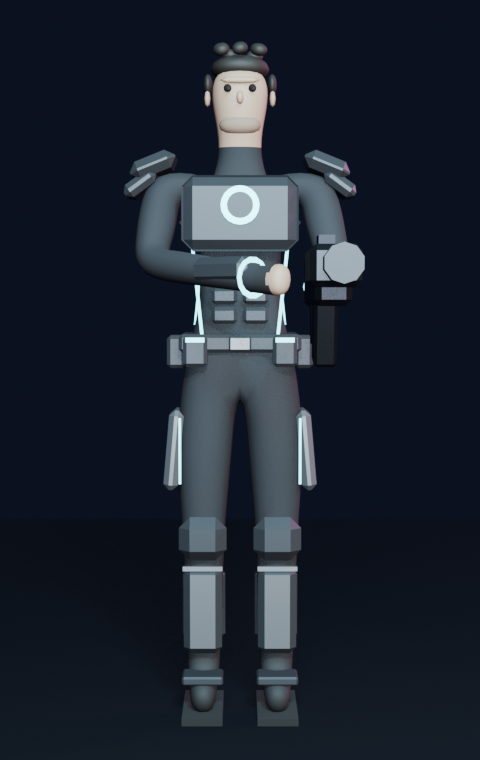 | 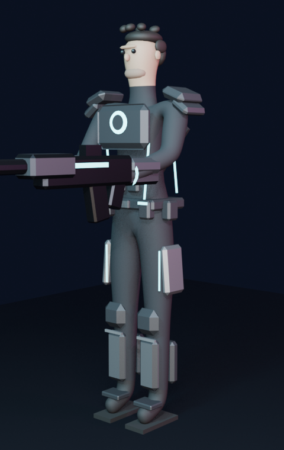 |  |

**In the game**
- He walks like a person: hip swing, **knees bend** as each leg swings through, a slight forward lean when running, and breathing when idle.
- The game computes each bone's swing axis from the model itself at load, so Blender's bone orientation never needs to be hand-matched.
- **"Dead in the system":** dashing or Shifting leaves a faint translucent copy of Jax behind, like a stale data trace of someone the system thinks is gone. It's off when Screen Effects is Off.
- The suit glow is turned down to accents, so the chest no longer turns into a floodlight.

**Bugs worth a video segment**
- *Armor fell to the floor:* attaching meshes to bones read the skeleton before Blender had computed it. Fixed by computing each piece's offset from the bone's rest position directly.
- *The walk animation moved nothing:* the model loader used a plain `clone()`, which leaves a skinned body attached to the **original** skeleton, so the game animated bones the body didn't follow. Fixed with `SkeletonUtils.clone`.
- *The afterimage was a blinding white blob:* a wireframe of a 24k-triangle body is effectively solid, and bloom made it glare. It's now a soft see-through silhouette.

---

## Day 1, part 9 — Jax v4: armor that's part of the body

Playtest feedback: *"still looks half human, half robot."* The box-shaped armor plates were the culprit.

**New technique: cut the armor from the body itself.** Select a region of the body surface (chest, back, shoulder caps, outer thighs, knees, shins, forearms, belt, the side piping), copy it, push it outward and give it thickness. The plates now **curve with the body like the molded armor in the reference**, and because they keep the body's bone weights, they bend with him when he moves. The body also got more anatomy: deltoids, a tapered chest, biceps, forearms, thighs and calves.

| Front | Back | Walking |
|---|---|---|
| 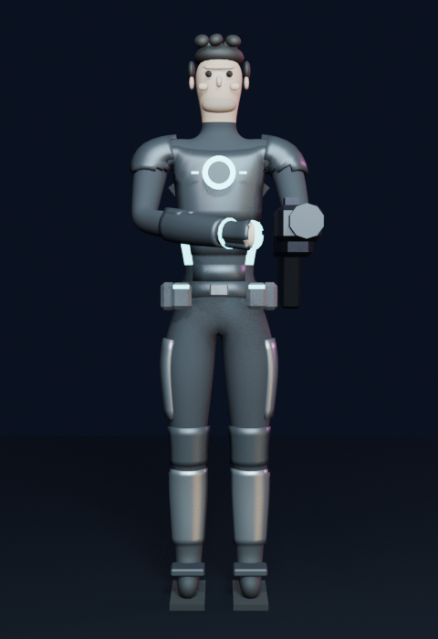 | 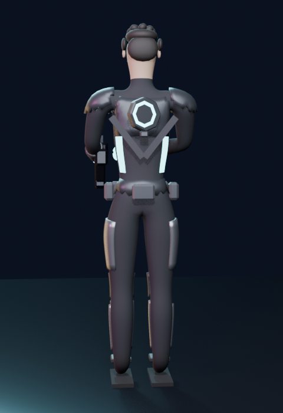 | 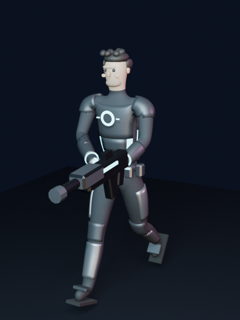 |

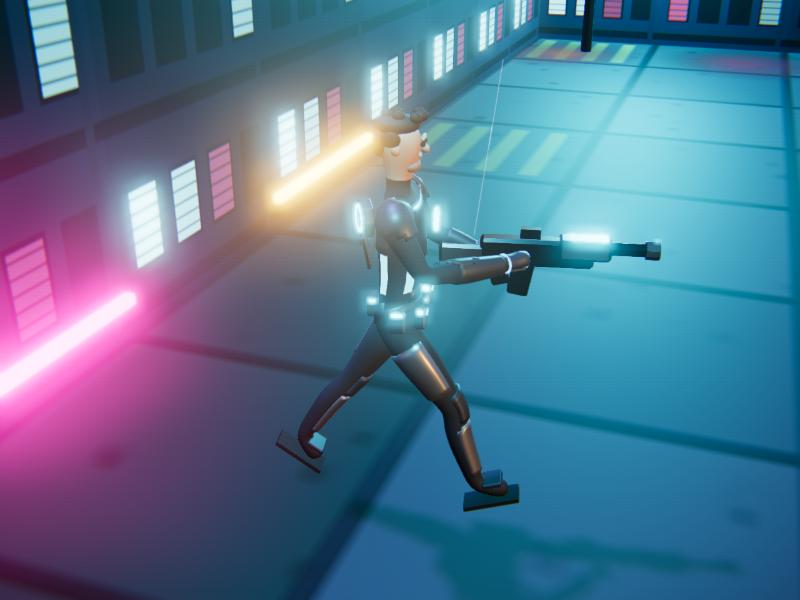

**Bug: green specks on Jax.** Some pixels on his model rendered at 65,504 (the render buffer's maximum) in one color channel. The safety filter scaled them down but kept the color, so they stayed pure green, and bloom spread them. Found by elimination: with the filter off the screen washed out white, and with bloom off the model was perfectly clean. Fix: no light in this game is legitimately brighter than about 100, so any pixel above 500 is blanked as an error, the same as NaN. The muzzle-flash light also moved half a meter off the barrel, since a light about 1 cm from a surface overflows the buffer on its own.

---

## Day 1, part 10 — Hard-surface props in SolidCraft

SolidCraft (a free, open-source CAD program in the style of Fusion 360) has a scriptable command line, so hard-surface models are now **generated from Python scripts**:
- `art/solidcraft/gen_rifle.py` → `rifle.json` → SolidCraft builds it → GLB.
- `art/solidcraft/gen_props.py` → terminal + crate.

Edit a number in the script, re-run it, and the model updates. The `.sc` design files are kept too, so they open in the SolidCraft app.

| Rifle | Terminal | Crate |
|---|---|---|
|  |  |  |

- **Rifle:** receiver with an ejection port, toothed top rail, vented handguard with cyan glow strips, barrel with a ported muzzle brake, angled magazine, raked grip, stock with a cut-out, optic. It replaced Jax's box rifle, with the grip in his right hand and his left hand on the handguard.
- **Terminal:** plinth, a body with cooling vents, a sloped control deck with keypad, a recessed screen in a bezel, a cable conduit and glowing base strips. Its screen is the hack indicator: cyan, turning green when hacked.
- **Crate:** corrugated steel shipping crate with corner castings, a lid and an amber hazard band. Every crate in a district is drawn as one instanced batch per part.

**Pipeline:** SolidCraft GLB → Blender (merge flat triangles, map body names to game materials, attach to Jax's chest bone) → `assets/models/`.
**Lesson:** CAD tessellation is heavy. The rifle came in at 40,350 triangles. Merging coplanar faces ("limited dissolve") cut it to **3,512 with no visible change**. The terminal and crate ended up at 698 and 488.

---

## Day 2 — Nov 13: Jax moves like a person; district select

**Feedback:** *"still a little stiff, robot-like."* The model was fine. The animation was the giveaway: his whole body turned as one block toward the aim, and when strafing his legs still swung forward and back, so he skated.

**What real people do, now in the game**
- **Legs follow the feet, chest follows the target.** His hips turn toward where he's walking (up to 66°) while the spine and chest unwind, so the rifle stays on the target. Walking mostly backwards switches to a backpedal: hips square, stride reversed. Verified: strafing right turns the hips -66°, strafing left +66°, forward and back 0°.
- **Counter-rotation:** the hips twist with each stride and the shoulders twist against them.
- **Hip drop:** a side-to-side tilt per step.
- **Planted feet:** the ankles cancel most of the leg pitch, so his feet stay flatter.
- **Head nod** with each step, and **idle weight shifts** and breathing when standing still.
- Technique: a `rotator(bone)` helper that applies pitch, yaw and roll in **model space** on top of each bone's rest pose. Blender's bone orientations never need to be known.

**District select (requested)**
- Title screen: **SELECT DISTRICT** lists every unlocked district. Cleared ones show ✓ and the **best time and score**. Pick one to replay it.
- **MAIN MENU** buttons on the win screen and in the pause menu.
- The win screen shows **NEW BEST** tags when you beat your record.
- Records are saved per district in the browser (`pb-records`).

**Follow-ups from playtest**
- **"When I turn my mouse, the character should turn."** Auto aim used to keep Jax locked on the nearest enemy all the time. Now **he always faces the mouse**, and auto aim only takes over **while fire is held**: he snaps to the target so shots land, then goes back to the mouse. The ring still shows which enemy it would pick.
- **District pictures in District Select.** Each card now has a real in-game overview shot of the district. They're generated by a dev tool: run `__makeThumbs()` in the browser console while `serve.py` is running, and it renders each district and saves `assets/thumbs/<id>.jpg`. `serve.py` got a tiny dev-only upload endpoint for this, locked to that folder and JPEG files. Locked districts show their picture greyed out and blurred.

### Next
- District 03 + a Warden boss fight at Portal Zero (model the Warden in Blender).
- Abilities Q/E/F (freeze, surge, cloak) from the old prototype.
- More Blender props: street kiosks, vending machines, holo-ad pillars.

### Day 2 — Movement follows the mouse
- WASD is now relative to where Jax faces: **W runs toward the mouse**, S backs away, A/D strafe around it. No more running into a wall because "up" on the keyboard didn't match where he was looking.
- It steers by the cursor, not the auto-aim lock, so holding fire never pulls you off course.
- The old screen-direction movement is still there: Esc → MOVEMENT: SCREEN (saved between sessions).

## Day 3 — 2026-11-13: District 03 // CRYO ADMIN

**New twist: security gates.** Orange laser curtains with a floating number badge. Unlike everything else in the game they're solid in *both* worlds, so phasing can't cheat past them. Each lock you crack reroutes power: gate 1 drops after one lock, gate 2 after two, gate 3 after three. That turns the district into four sealed zones you clear in a loop.

- Zone 1: an easy city terminal to learn the gate rule.
- Zone 2: a chasm crossed by City glass *or* a Breach bridge, rift node on the far side.
- Zone 3: a terminal sealed inside a holo-barrier box. Phase in through the wall, shift back inside, hack.
- Zone 4: glass and bridge over the void again, the last rift node, and the exit.
- The waypoint now skips locks that are still behind a closed gate (each lock knows which gate level it's behind, worked out with a flood fill from the start).
- The minimap draws closed gates in orange; wraith pathing updates the moment a gate drops.
- Map generated by a script that proves the progression: 1 lock reachable at the start, 2 after gate 1, 3 after gate 2, all 4 plus the exit after gate 3.

**Story setup:** the briefing after District 03 points to the hypersleep bay. That's District 05: a room of pods where Jax finds a crew ID card that wakes a new playable character. More cards later unlock more pod characters, each with their own Shift/right-click ability (first one: **Remote Hack**). Tab will swap between unlocked characters.

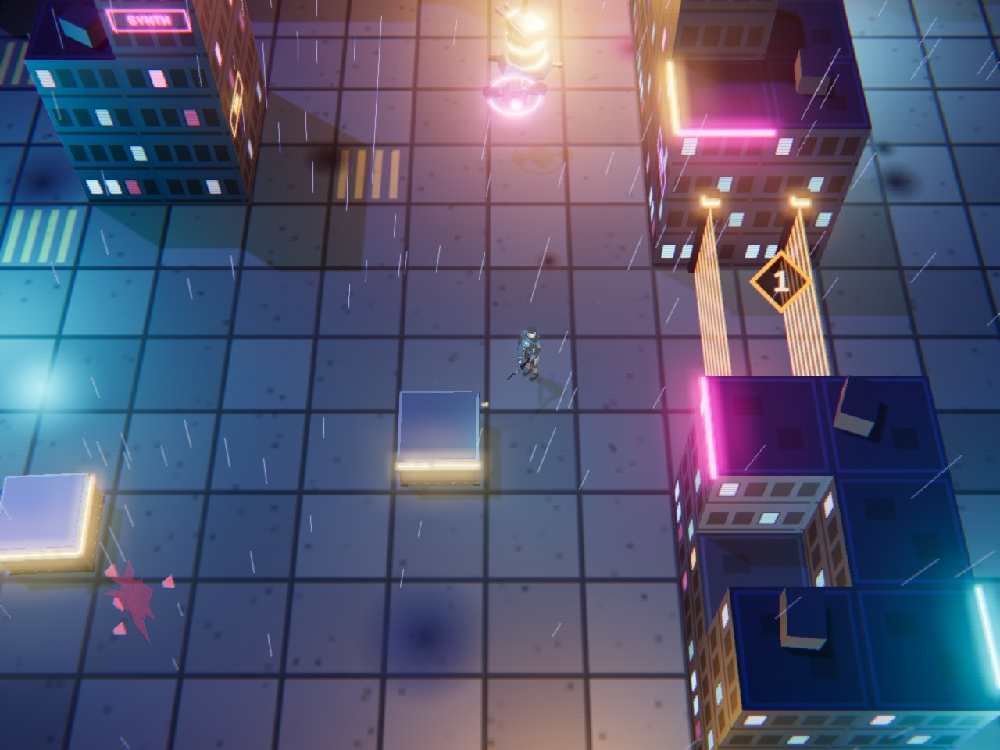

## Day 3 (cont.) — District 04 // COOLANT WORKS

**New twist: coolant vents.** Floor grates that blast freezing coolant in waves rolling east across the map. The rule is pure SHIFT: they only fire in the **City**. In the **Breach** they're dead, but the Breach drains your phase energy, so every vent field is a choice:
- time it: grates glow **amber** just before they fire, **blue jets** while blasting (12 damage, once per blast)
- **dash** through (you're invulnerable mid-dash)
- or **shift** across and race your energy bar back to solid City ground

Layout: a vent band north of the start, a huge central coolant hall with safe islands around a rift node, a terminal sealed in a holo-barrier box behind another vent strip, and a void crossing with a vent ledge before the last rift node and the exit. The script check confirms all four locks and the exit are reachable.

First pass looked like a glowing striped carpet with a white-out where the wave fired (60 additive jets + bloom). Toned the grates down and made the jets thinner and dimmer so each one reads on its own.

## Day 3 (cont.) — District 05 // HYPERSLEEP BAY: the crew system

**The big one: a second playable character.** District 05 is a hall full of hypersleep pods. Most sleepers are long gone, but three crew pods have numbers on them: 03, 07 and 11. Each one opens with that crew member's **ID card**, and the cards are scattered across the station.

This district hides the first card in a records office behind security gate 1. Bring it to **Pod 07**, it thaws, and **Iris Rook** wakes up: a netrunner who thought she was dead too.

**How the crew works:**
- **TAB** (or 1–4) swaps characters mid-stage
- **SHIFT / right click** fires the *current* character's ability. Jax keeps the phase shift.
- **Rook's REMOTE HACK** reaches the terminal or turret nearest your cursor, up to 16m away, **through walls**. A green uplink beam locks on and the hack runs on its own.
  - Hacking a turret **hijacks** it for 12 seconds, and it turns on its old friends.
  - Rook can't phase, so the levels make you swap: Rook for the sealed stuff, Jax for the Breach.
- Unlocked crew is saved, and Rook comes with you into every district (replays included).

**The puzzle that needs her:** one lock sits inside a **sealed glass vault**, solid in *both* worlds, so the Breach can't get you in. You can see the terminal through the glass, and only a remote hack reaches it. That lock powers gate 2, which leads to the rift node and the exit, so you need both characters to finish.

The waypoint follows the story: first lock → ID card → Pod 07 → vault → rift node → exit.

First pass of the vault: the glass "rim" was a full glowing cap on every tile, so the whole ring bloomed into a white rectangle. I dimmed it, and now you can see the beam cut through the glass.

Rook uses Jax's body for now, recolored in acid green. She needs her own Blender model.

## Day 4 — 2026-11-16: Waking up in the hypersleep chamber

**Restructure: the hypersleep chamber moves to the very start.** The intro already said *"Wake up, explorer. Life support failing."*, but you just spawned on a street. Now the pods are where the story begins.

**District 01 opens in the chamber.** A row of dead sleepers, the three numbered crew pods (03, 07, 11), and **Pod 01: Jax's own.** On the briefing screen it's shut and pulsing amber with him inside. When you enter the district, the lid lifts, cold fog rolls out, and Jax climbs out. You walk past Rook's pod in the first ten seconds, still locked, so you know someone else is in there.

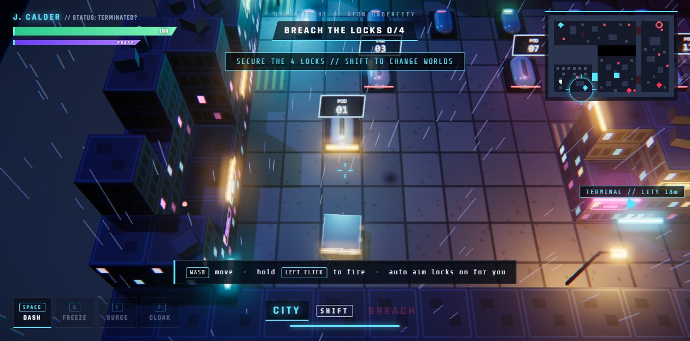
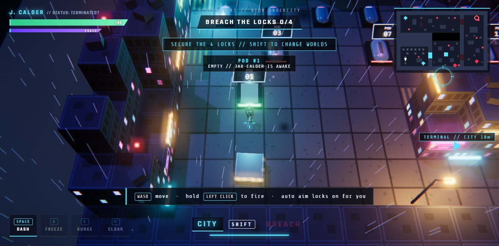

**Rook's ID card is now in District 03 // Cryo Admin**, in the top-right wing behind gate 2, next to a rift turret. Picking it up wakes her on the spot: the station verifies the card, Pod 07 back in the chamber thaws, and she patches into your link. Replay District 01 afterwards and her pod is open and empty.

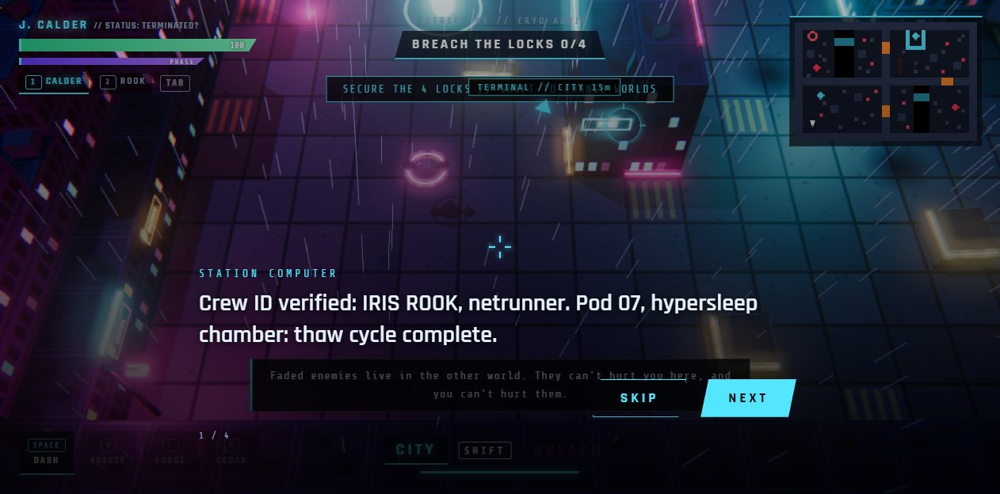

**District 05 becomes PORTAL ZERO.** The pod room is gone. That hall is now plain floor with a little cover, and everything else stays: the sealed glass vault, the gates, the rift node and the portal room. Next, the **Warden** moves into the portal room. Once its door opens, you have to beat him before the last portal activates.

**New rule: a district can need a character.** District 05's vault can only be hacked by Rook, so the level now says `needs: "rook"`. Pick it from District Select and she's brought along and selected automatically, even if you skipped her card. The game can't softlock on a missing crew member.

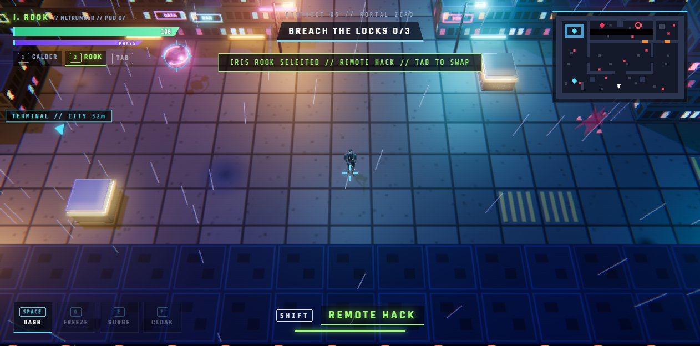

The script check confirms every lock, the card and the exit are still reachable in all five districts. A headless playtest covered the full chain: wake up, card → Rook, District 05 as Rook. New District Select thumbnails for 01 (the chamber) and 05 (the vault).

## Day 5 — 2026-11-17: Two bars each, and a tube in the wall

**Every crew member now has their own health and phase energy.** Before, Jax and Rook shared one body's worth of bars, so swapping was just a recolor. Now TAB parks the current character's health and energy and brings in the other's. The big bars always show who you're playing. Under them, each crew card has its own mini health bar (green) and energy bar (violet), so you can see Jax at 40% while you're running around as Rook. A benched character slowly patches themselves up. Swapping out of a bad fight is a real move now.

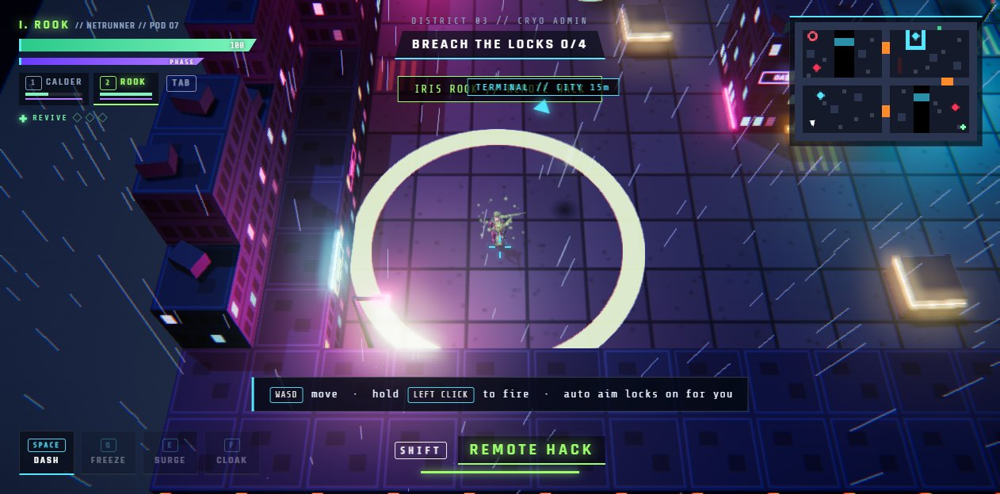

**Going down instead of game over.** If the character you're playing hits zero while a teammate is still standing, they go **down** in a burst of their color, and the teammate takes over right where they fell. The downed card turns red with DOWN on it, and TAB refuses to swap to them. Lose the whole crew and it's the old "SIGNAL LOST" screen, now reading *WHOLE CREW DOWN*. The checkpoint brings everyone back.

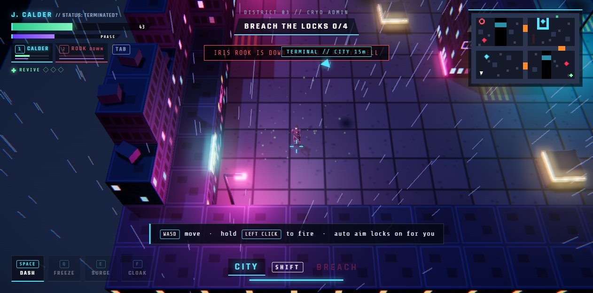

**Revive chambers.** Every district has one: a glass tube set into a wall, glowing green fluid, a cross sign above it and a ring on the floor in front. **Revive cells** are hidden around each district (a small glowing vial, a green cross on the minimap). You can carry three, and they stay with you between districts. With a crew member down and a cell in your pocket, the waypoint points at the chamber. Stand on the ring and the tube floods bright green while their silhouette fills in. A second and a half later they're back at full health.

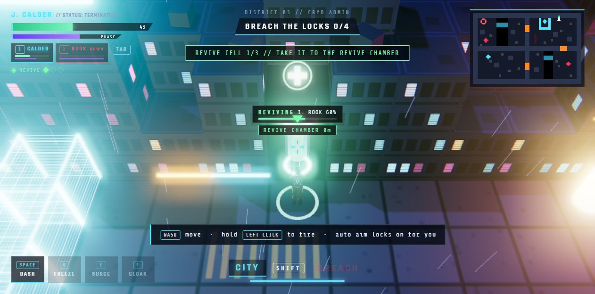

Where they are: District 01 has its tube in the hypersleep chamber, right above the pods. District 02 puts it on the middle island, District 03 next to Rook's ID card, and District 04 on the corridor over the vent field. District 05 puts it in the main hall, directly below the door to the portal room, so you can patch the crew up before the Warden fight.

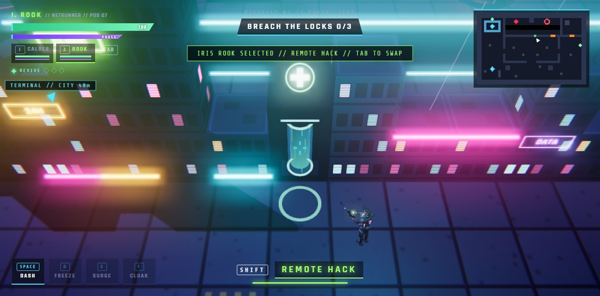

The map check now also confirms every district has exactly one chamber with floor in front of it and that every cell can be reached. A new headless playtest went through the whole loop: separate bars, swap, Rook goes down, Jax takes over, no swap to a downed crew member, a chamber without a cell does nothing, pick up a cell, revive, swap back, then both down for the game over screen. 20/20 passed, and the 12 earlier checks still pass.

## Day 5 (cont.) — 2026-11-17: Hollis Crane, the tank who throws things

**A third crew member.** Pod 11 finally has a name: **Hollis Crane**, heavy lifter. His ID card sits in a dead-end alcove in District 04, just north of the revive chamber, guarded by a drone. Pick it up and he climbs out of his pod asking whether he dropped the reactor core he was carrying. He's the tank: **160 health** where Jax and Rook have 100, a little slower on his feet, and built bigger. For now he's Jax's body scaled up and tinted violet, until he gets his own model.

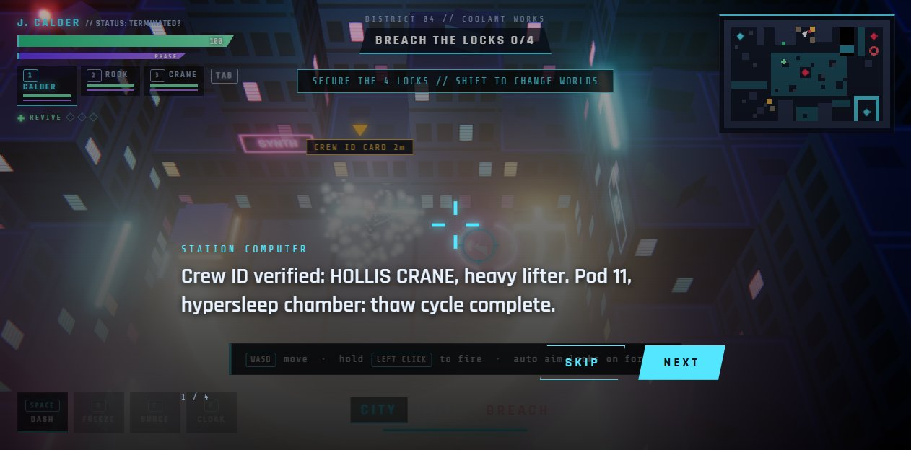

**SHIFT is grab and throw.** Walk up to a heavy crate (orange band) or a small enemy and a prompt pops up: SHIFT LIFT. Crane hoists it over his head, puts his rifle away and slows down under the weight. SHIFT again, or a left click, throws it where you aim. It flies in a short arc and smashes on the first wall or enemy it meets, or where it lands, and everything within a few meters takes a hit and gets knocked back. Drones and wraiths count as small enemies. A thrown one doesn't get back up.

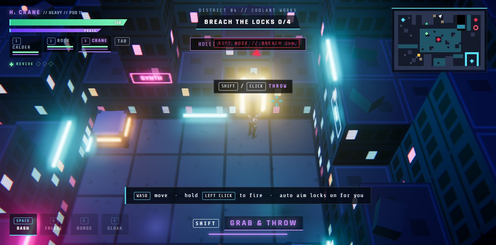
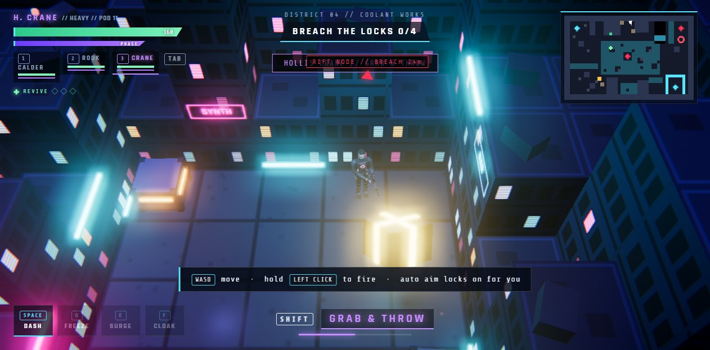
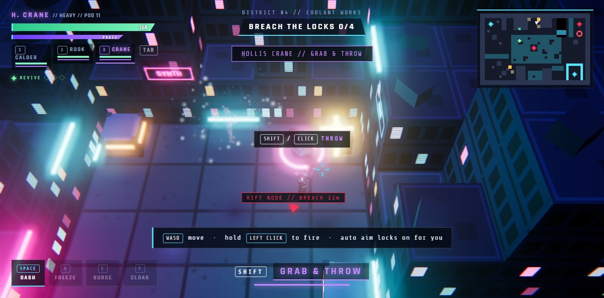

**Supply crates.** Some crates are tied up with glowing gold straps and a bow on top, like a present. Throw one and it breaks open with something inside. Each district lists what its supply crates hold, so the good stuff is placed on purpose: District 04's first one has a **scatter gun**, District 05 has a **rail gun** behind gate 1 and a **revive cell** near the start. Plain crates sometimes spill a health or energy pickup.

**Pickup weapons.** The scatter gun fires a 6-pellet fan (36 shots). The rail gun fires slow, heavy rounds that punch through three enemies (20 shots). A pickup weapon replaces the rifle until it's empty, shows its name and ammo under the revive counter, and belongs to whoever picked it up: swap to Jax and he has his rifle, swap back and Crane still has the scatter gun.

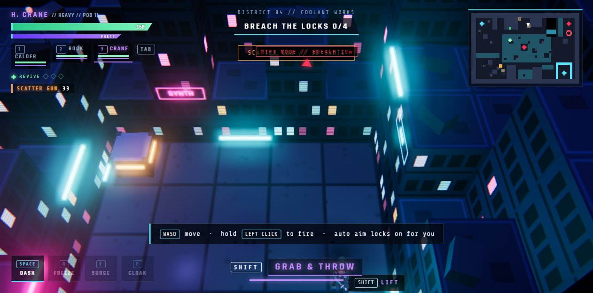

Nothing in any district needs Crane to finish it: the map check treats every throwable crate as a solid wall and still reaches every lock, card and exit. It also checks that Crane can walk up to each crate. Restarting a district puts every crate back.

Two small fixes on the way: a click now counts even if it starts and ends between two frames (that matters on slow machines, and it's how the headless playtest found it), and the waypoint pinned to the top edge of the screen sits lower now, so it stops covering the toast messages.

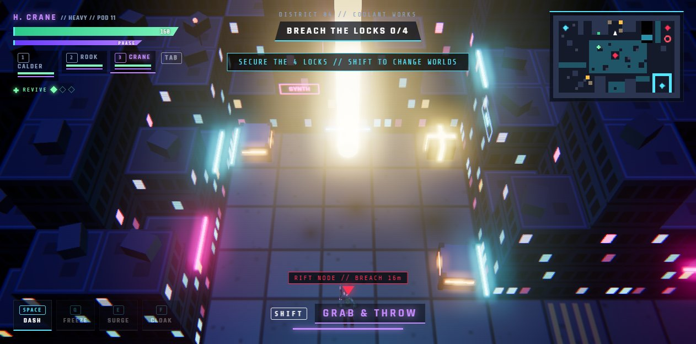

A new headless playtest covers Crane end to end: the card and wake-up story, 160 health and the HUD, lifting (the crate's tile turns into floor), throwing a supply crate open, picking up and firing the scatter gun, keeping it through a swap, grabbing and throwing a drone, a plain crate, dropping a crate by swapping out, the district restart, District 05's revive cell crate, and the rail gun. 22/22 passed, and the 12 older crew checks still pass.

## Day 5 (cont.) — 2026-11-17: Crew terminals, "Boulder", and real bodies from Rodin

**ID cards go to a terminal now.** Picking up a crew ID card used to wake that sleeper on the spot. Now it only tells you *ID CARD: IRIS ROOK // TAKE IT TO THE CREW TERMINAL*. Every district with a card has one **crew terminal**: a console set into a wall, with a desk, a card slot, a screen reading INSERT CREW ID and a gold ID-card badge floating above it. While you carry the card, the objective line and the waypoint send you there. Stand on the ring in front of it, the ID uploads with a progress bar, and the pod back in the hypersleep chamber thaws. Then the wake-up scene plays as before. The card stays with you if you die and respawn at a checkpoint. District 03's terminal is in the north wall next to the revive tube, a few steps from Rook's card. District 04's is right beside its revive tube, just below Crane's alcove. The map check now makes sure every district with a card has exactly one terminal you can walk up to.

**Hollis "Boulder" Crane.** The tank has a callsign. The HUD calls him BOULDER, and his wake-up line now includes "Call me Boulder, everybody does."

**Real bodies for the crew.** The concept art for Jax, Iris and Boulder went through **Hyper3D Rodin** (image to 3D). Each one came back as a 1,000,000-face model with full PBR textures, way too heavy for a browser game, so in Blender each model gets:

- **cut down** to 20,000 triangles, with its textures shrunk to 1K
- **scaled** to Jax's height and centered on its legs
- **given Jax's skeleton**, with the leg bones moved to fit the new body

Rodin didn't use the T/A pose, so all three came back holding their rifle straight out in front. That's exactly the pose the game wants: the game never animates the arms, only the legs, hips, spine and head. So the arms, the backpack and the collar ride on the chest, and the rifle (fused into the hands) gets its own **Gun** bone so recoil still kicks it back. A **Muzzle** point at the barrel tip tells the game where the bullets come from. The glow in each texture was turned grey, so the game can tint it: Jax's lines follow the world he's in (cyan in the City, red in the Breach), Rook's glow green and Boulder's glow violet.

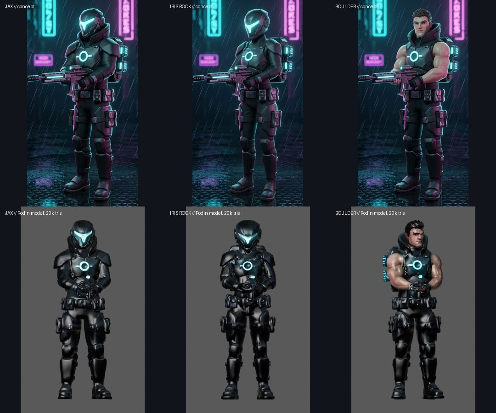
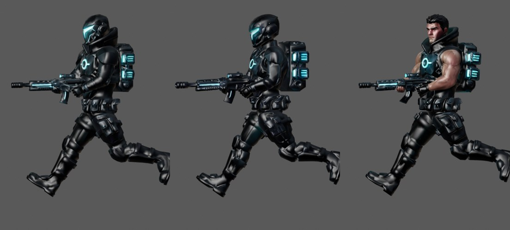

Each crew member now switches to their own model when you swap, and the hand-built Jax stays in as the backup if a model ever fails to load. Each file is about 1 MB. Next: seeing them under the game's lights, and the next Rodin batch (Santa, both launchers, the Warden, and new drone, turret and wraith designs).

**Legs that actually run.** In the game the new bodies looked like they were dragging their legs. The walk had always been a bit weak: the stride was too short for how fast you move, so the feet slid along the floor, and the knee only bent about 45°. The bigger, more detailed Rodin bodies made it obvious. The new run takes longer, quicker strides sized to the movement speed, and the knee starts bending at push-off and tucks the heel up behind (up to about 80°) as the leg swings through, then straightens to plant. The hips bounce a little more and the body leans into the run. Boulder takes longer, slower steps because he's bigger. The hand-built Jax uses the same code, so he runs better too.

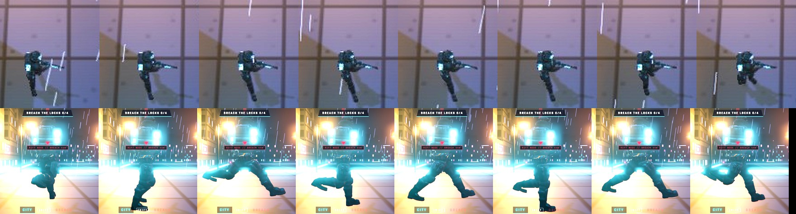

## Day 6 — 2026-11-18: New enemies from Rodin, and a body for the Warden

**The second Rodin batch is in:** the Warden (District 05's boss), the drone, the turret and the wraith, all from the concept art. Same route as the crew: Rodin gives back a 1,000,000-face model with 2K PBR textures, and Blender cuts it down. The enemies go down to 6–7k triangles each, because a room can hold a lot of them. The Warden keeps 20k.

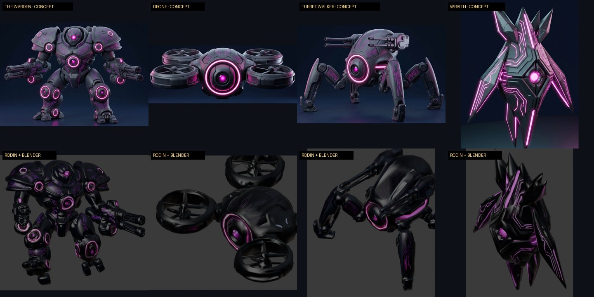

**Splitting off the moving parts.** A Rodin model is one solid piece, but the game moves parts of each enemy in code, so Blender cuts them apart by position:

- **Drone:** each of the 4 rotors is found by fitting a circle to the rim of its fan duct. Everything inside the duct (blades and hub) becomes its own part, `Rotor1`–`Rotor4`, spinning around its own center. Opposite rotors spin opposite ways.
- **Turret:** it's now a **four-legged walker**. The dome, its eye and the twin gun pods turn as one piece (`Head`) on top of legs that stay planted.
- **Wraith:** one floating crystal that bobs and now sways a little as it drifts.

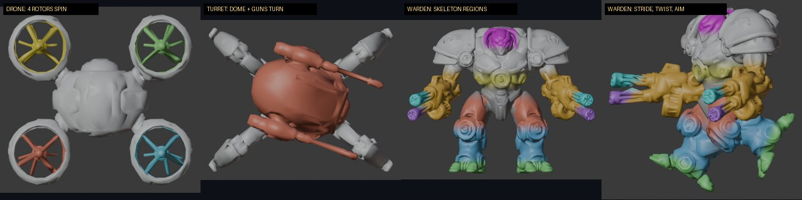

**The glow keeps meaning something.** Each texture's glow was turned grey, like the crew's, so the game colors it per enemy: drones pink, turrets orange in the City, rift turrets crimson in the Breach, wraiths red. The attack warning that used to flash a small eye now pulses every glow line on the model. A wraith about to lunge flares brighter, and a hit flashes the whole body. The Rodin glow rings are much bigger than the old eye lenses, so the glow is turned down to keep the bloom from washing out the model.

**A turret bug the old model hid.** Every turret spawns turned a random way, and the head was aimed as if the body wasn't turned. Bullets went at you, but the barrels could point somewhere else entirely. The old boxy turret looked about the same from every side, so nobody noticed. The walker would have given it away, so the head now aims in world space and the barrels point where the bullets go (checked in the game: the barrels point straight at you, even on a turret whose body faces a different way).

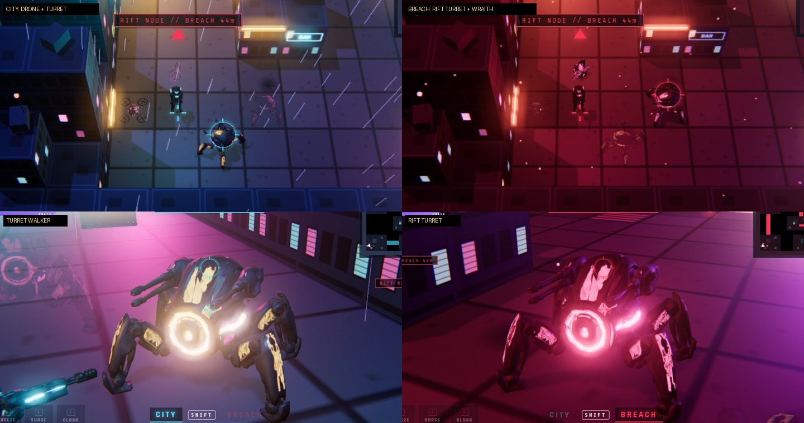

**The Warden.** He gets his own skeleton for the boss fight: legs that walk, a waist that twists, and two arms that aim from the shoulder. Each arm carries **two rotary cannons**. Blender finds each barrel cluster (the two on an arm are stacked with only about 1 cm between them), works out which way it points, and gives it a bone so the barrels can spin around their own axis while he fires. There's a `Muzzle` point at the tip of each of the four cannons. He's 3.4 m tall, nearly twice Jax's height. The model is ready (`assets/models/warden.glb`), but the fight in the Portal Zero portal room isn't built yet, so the game doesn't load him yet.

**Santa, parked behind a switch.** The Christmas event is on hold, but Rodin is only on hand for a few more days, so Santa's model is made now and kept out of the game. He came back in a clean A-pose with his snowball launcher left off (it's its own model, still to come), so the crew's rig script, which expects a gun in the hands, didn't fit. A new script (`rig_unarmed.py`) gives him Jax's skeleton and moves Jax's arm bones onto Santa's hanging arms, so the arms can be posed later to hold the launcher. It finds each arm by walking the mesh from the fingertip up to the shoulder, staying outside the torso and in front of the backpack. A first try that sliced the body by height missed some fingertip vertices, and those stretched into long spikes as soon as the arms moved. A `Gun` bone on his right hand is where the launcher will attach. `src/events.js` lists the Christmas event as off, and while it's off the game never even downloads `santa.glb`.

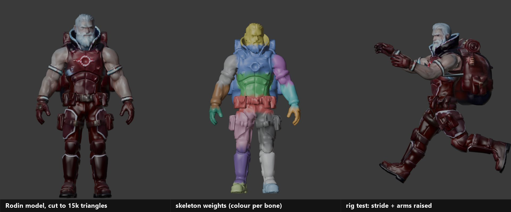

**A snowman, behind the same switch.** The Christmas event gets an enemy: an armored robot snowman with a carrot nose, coal buttons, ice-crystal spikes down his back, and two clawed gauntlets that float beside him. He's cut to 8k triangles and stands 1.8 m tall. The gauntlets came out of Rodin as separate pieces of the mesh, so splitting them off was clean. His bottom snowball is cut away at the narrowest point of his waist, and a sphere fitted through it puts its centre exactly one radius off the floor, so it can roll under him without bobbing. That leaves four parts that move in code: the ball rolls, the body turns to face you, and each gauntlet can bob and swipe on its own. Like Santa, he's listed under the Christmas event in `src/events.js` and never loads while the event is off.

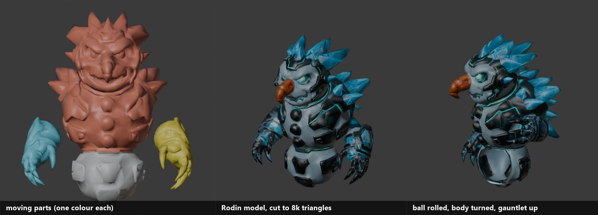

**Iris gets a Christmas skin.** Her Christmas outfit (candy-cane stripes, green, gold and silver armor) came back from Rodin as a whole new model, while the skins so far only recolor the same model. So a skin can now name a model of its own, and the game puts that model on her instead of her usual one. The skin is tagged with the Christmas event: while the event is off it's left out of the skin list, it counts as locked, and even a saved choice from an old event falls back to her normal look. Checked in Node both ways: with the event off she wears her netrunner suit and no Christmas model loads; switched on, the CANDY CANE skin shows up and swaps her model. She came in a wide A-pose with her arms 43° out, so the unarmed rig script now measures each arm from the shoulder to the fingertip instead of by height. Bringing the arms down to her sides in the rig test works without tearing at the shoulders. Two things wait for the event itself: Rodin left her gun out (the `Gun` bone on her right hand is where one attaches, and the arms need posing to hold it), and this model has no glow map, so the crew color and phase tint don't show on it.

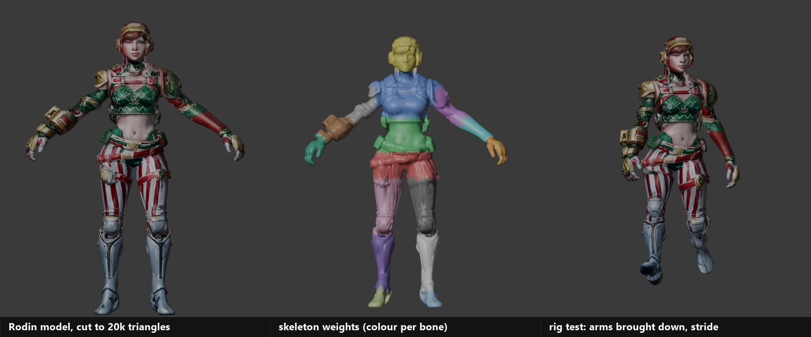

**Weapons become their own models.** Every character will be able to carry every weapon and wear every skin, so a weapon can't be part of a character's body any more. The plan: all characters and skins come out of Rodin empty-handed, every weapon is a separate model, and the game puts the weapon in the right hand and poses the arms to hold it. The first one is the **present launcher** for the Christmas event: red and gold, a bow on the barrel, a bell muzzle and a drum full of wrapped gifts. A new script (`weapon_prep.py`) lies it down the way the game holds weapons, barrel forward and handles down, and sizes it to 0.85 m. It finds the two handles below the barrel on either side of the drum (0.43 m apart, about right for two hands) and marks three points: `Grip` for the right hand, which is also the model's origin, `Foregrip` for the left hand, and `Muzzle` in the bell, where shots will come from. It sits behind the Christmas switch with the rest, and the holding itself comes once the empty-handed crew are in.

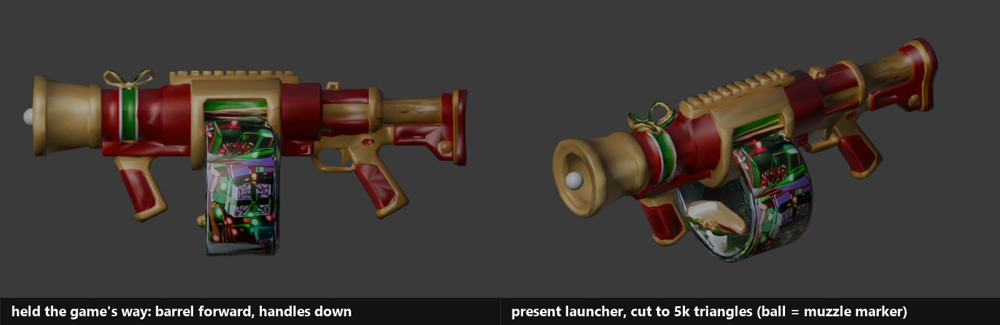
